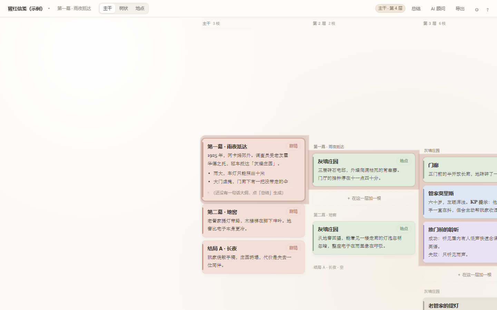
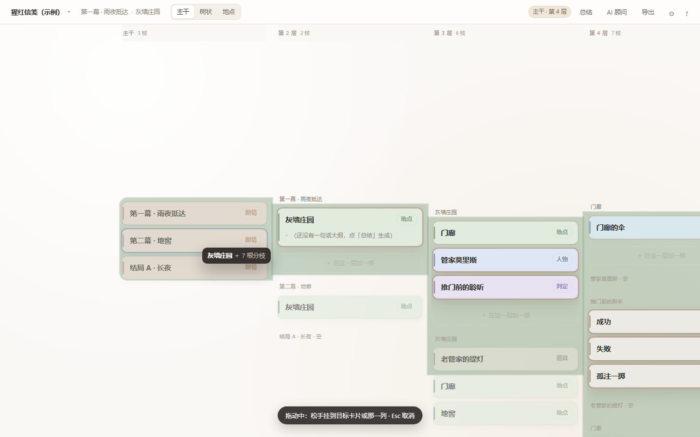
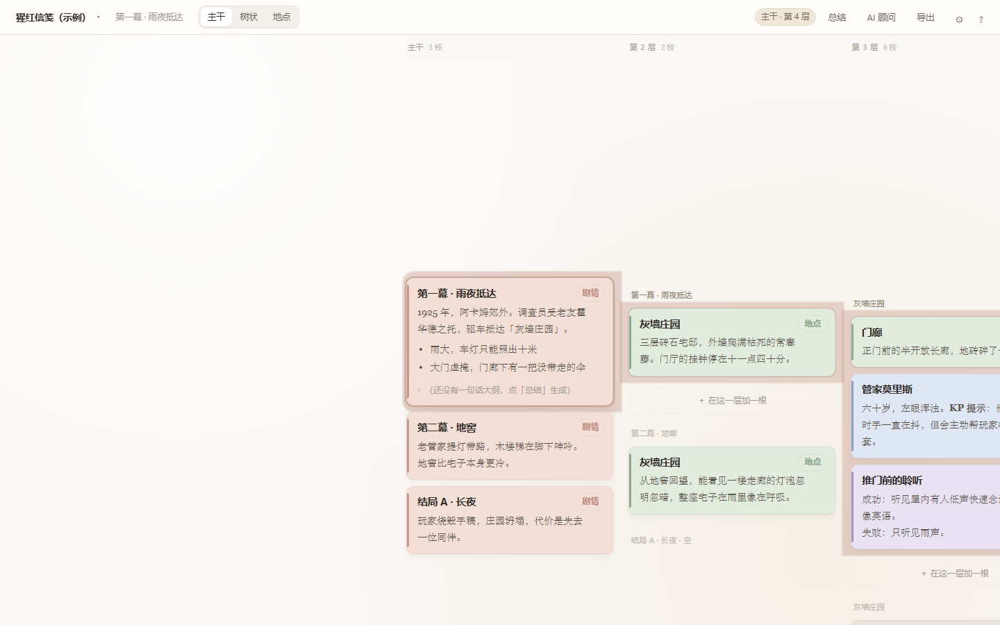
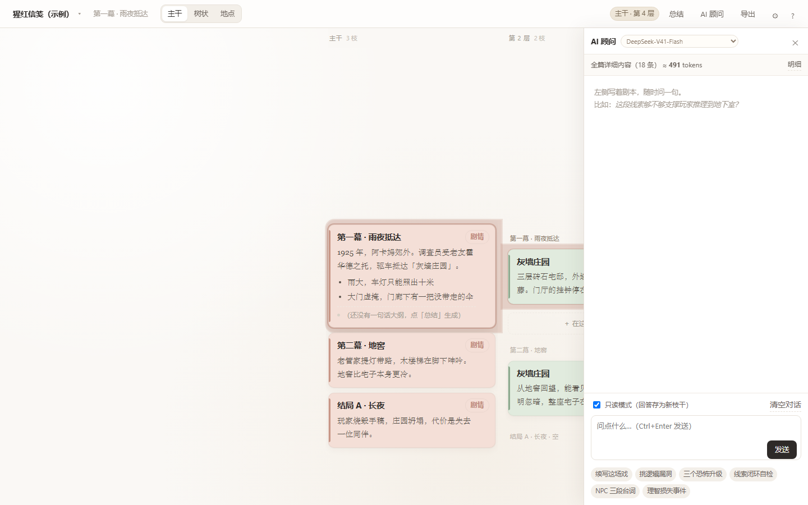

# 枝条笔记 · DSH 插件

把 coc-notes 那套「枝条笔记」搬进 DeepSeek Harness：左侧栏多一个枝条图标，点开就是整块笔记面板 —— 一层一列的枝条卡片、包络色带、长按拖动换父枝，AI 抽屉与「一键总结」直接使用 Harness 内置模型。

**关键差别：不再需要任何 DeepSeek API Key。** 页面里的 AI 抽屉、自动总结都走 Harness 自己的模型凭据（`ctx.llm` + 当前默认模型），Key 从头到尾不经过页面、不进 localStorage、不落盘。

## 安装

装完刷新一次 Harness 窗口（`Ctrl+R`），左侧竖排图标里会多一个枝条图标。

**方式一：插件市场（推荐，收录后可用）** — DSH 的「插件 → 发现」里搜「枝条笔记」，一键安装。

**方式二：命令行（npm 或 GitHub）**

```powershell
dsh plugin --profile desktop add dsh-branch-notes                  # 从 npm 装
dsh plugin --profile desktop add github:Magelovania/dsh-branch-notes      # 直接从 GitHub 装
```

**方式三：本地源码（开发用）** — 见文末「本机开发」。

- 宿主路由前缀：`/api/dsh-branch-notes`
- 数据目录：`~/.dsh/branch-notes`（日志、开发开关、导出中转都在这里）
- 无需任何 API Key：AI 走 `ctx.llm` + `ctx.agentDefaultModel`，模型目录与凭据都由 Harness 管理

## 截图

| 主干视图（一层一列，包络色带） | 长按拖动换父枝（全部折叠成标题） |
| --- | --- |
|  |  |

| 包络跟随选中项换色 | AI 抽屉里切模型 |
| --- | --- |
|  |  |

## 用起来

刷新一次 DeepSeek Harness 窗口（`Ctrl+R`），左侧竖排图标里会多一个**枝条图标**，点它切到「枝条笔记」中央面板。面板里就是原来的编辑器：

**也可以让 AI 直接打开。** 插件注册了一个工具 `branch_notes_open`，在任何对话里说「打开枝条笔记」「把剧本面板打开」「打开分支笔记，定位到灰墙庄园」都行；模型调用工具后，宿主写一条命令，客户端每秒轮询一次并自动切到面板（带标题时还会跳到那根枝条）。同样可以手工触发：

```powershell
$b = 'http://127.0.0.1:19387/api/dsh-branch-notes'
[IO.File]::WriteAllText("$env:TEMP\cmd.json", '{"note":"","reload":true}', (New-Object Text.UTF8Encoding($false)))
curl.exe -s -X POST --data-binary "@$env:TEMP\cmd.json" -H "Content-Type: application/json" "$b/commands"
```

`reload:true` 会让面板里的页面重新加载一次（不刷新整个 Harness 窗口），改了 `web/app.html` 后用它。

| 操作 | 快捷键 |
| --- | --- |
| 新建子枝 / 同级枝 | `Tab` / `Enter`（不在编辑时）；判定的卡片还没有结果时，`Tab` = 生成判定三分支（会先问判定名） |
| 保存编辑 | `Enter`（标题、正文一样，专注模式也一样）；或点空白处 |
| 编辑选中卡片 | `F2` 或 `e` = 改标题；`Shift + F2` / `Shift + E` = 改正文（方向键选完直接按，不用双击） |
| 正文换行 | `Shift + Enter` |
| 回到开头 / 跳到末尾（主干视图） | `Home` / `End`；想彻底回到「默认位置」也按 `Home` |
| 提升层级 | `Shift + Tab` |
| 专注写作 | 双击枝条，或 `Ctrl + Enter`，`Esc` 退出 |
| AI 抽屉 | `Ctrl + J` |
| 搜索 | `Ctrl + K` |
| 缩放 / 适应全图 | `Ctrl + 滚轮` / `F` |
| 导出 Markdown | `Ctrl + Alt + S` |
| 撤销 | `Ctrl + Z` |

- **总结（生成即锁定）**：点顶部「总结」只补 / 更新**还没锁定**的条目，每条生成完会**自动锁定**——所以再点一次「总结」不会重算、也不花钱。卡片大纲左边那个小圆点就是锁状态，**点它可切换锁定 / 解锁**（解锁的条目下次「总结」会重算；正文改过但没锁的会显示「待更新」）。双击大纲文字可以直接改，改完自动视为锁定。

AI 抽屉里的「上下文」默认**只发一句话大纲 + 当前节点全文**（不再是整篇正文）：每条笔记一行「- 标题（类型）：一句话大纲」，加上你正在看的那一条的完整正文和它的上级脉络。抽屉顶部那行上下文右边有 **「大纲 / 全文」** 按钮可切：

- **大纲（默认）**：省 token，模型靠大纲理解全局，缺细节时会先说「我需要 XXX 那条的正文」。
- **全文**：整篇每个节点的完整正文都发过去，适合「通篇找矛盾」这类问题（更贵更慢）。
- **专注写作**（双击 / `Ctrl + Enter`）：固定读「当前节点全文 + 祖先两层 + 大纲」，不受开关影响，`Esc` 退出后回到你选的模式。

只读模式默认勾选，回答可以「存为新枝干」。

**三种视图**（顶栏切换，默认「主干」）：

- **主干**（默认）：一层一列、默认全展开。最左一列是主干卡片（和分支一样是卡片，不是侧边栏），同一层的枝条都排在同一列里，每列自己独立上下滑；选中某个卡片，它的下一级分支出现在它右边那一列，依此类推，越深越往右。打开时沿每层第一根子枝自动展开到底，所有层级的列一开始就在。 单击卡片会把它横纵都移到屏幕正中，而且是**从当前位置平滑滑过去**（约 0.34 秒，中途拖动画布或滚轮立刻接管；系统开了「减少动态效果」就直接到位）。
- **包络色带**：当前主干的整棵树会被一条半透明色带罩住（从主干卡一直包到它最深的分支），一眼看出谁挂在谁下面；默认跟主干同色。选中某个分支时，包络自动收成「这条分支 + 它的祖先链 + 它的下级」，**不包同级**，颜色换成该分支的类型色。包络画在卡片下面、跟着每列滚动一起走，横向拖动画布时也贴着卡片。

  三件事让这列视图好读：

  ① **每列按「上一层的卡片」分组**：第 2 列里，第一幕的分支一组、第二幕的分支一组、结局 A 一组（空组显示「· 空」），组头写着它属于哪张卡片。所以看主干 B 的时候，上面一段就是主干 A 的分支、下面一段是主干 C 的分支 —— 相邻主干互相可见，在 B 下面新建分支也立刻出现在 B 那一组里。分支往下递归同理（第 3 列按第 2 列的卡片分组）。
  ② **当前项永远在屏幕垂直中线上**：选中的主干卡片居中（第一根、最后一根也一样），选中的分支居中；它右边那列的分支从与它平齐的位置往下排，所以「它下面的分支」和「它上面那根枝条的分支」能同屏对照。
  ③ **路径高亮**：从主干到你选中的那张卡片，中间每一列的当前项都描一道浅赭色细边，一眼看出这枝挂在哪根主干上。

  操作：`单击` = 选中，并把这张卡片滚到屏幕正中（横向、纵向都居中，第一根/最后一根主干也一样）；`双击` = 进入编辑（双击标题改标题、双击正文改正文，文本框限制在列宽内，不会撑破卡片）。**编辑时的回车**：`回车` = 保存当前编辑并退出（改标题、改正文都一样，专注写作里也一样，不会顺手建分支）；要换行按 `Shift + 回车`（只在正文里有效）；点旁边空白处同样是保存退出（点别的卡片也一样）。选中态（不在编辑）下 `Tab` = 建下级分支、`Enter` = 建同级分支，两者建完都**自动进入新卡片的标题编辑**并**把新卡片移到屏幕正中**，直接接着打字即可；列尾「＋ 在这一层加一根」也能建。切换主干直接**点左列的主干卡片**即可，无冻结、无额外手势。

- **长按拖动换父枝**：按住任意卡片约半秒不动（短按仍是选中，移动超过 8px 就当作拖画布），就进入拖动模式 —— 这张卡片连同它下面整棵树一起被拎起（描边高亮、浮层显示「标题 ＋ N 根分枝」），同时**所有卡片折叠成只显示标题**，方便看清落点。松手时：落到**另一张卡片**上 = 变成它的子枝（连同子孙一起搬过去）；落到某一列的分组空白处 = 挂到那一组的父节点下面；落到最左列空白 = 变成主干。落点是它自己或它自己的子孙会被拒绝（提示一下，不改结构）；拖动中按 `Esc` 取消；搬完 `Ctrl+Z` 能撤销。

  判定分支：卡片菜单里的「生成判定三分支…」、以及**选中一张还没有结果的「判定」卡片后按 `Tab`**，都会先弹一个窗口问**判定名称**（默认填当前卡片标题，回车即用）。这个名字**只用来给三根结果子枝命名，不会改动这张判定卡片自己的标题**：**成功·<判定名> / 失败·<判定名> / 孤注一掷·<判定名>**（例如名字叫「推门前的聆听」，三根就是「成功·推门前的聆听 / 失败·推门前的聆听 / 孤注一掷·推门前的聆听」）；名字留空则三根只叫「成功 / 失败 / 孤注一掷」。卡片标题始终由你自己双击修改，弹窗不会碰它。生成的同时卡片类型自动变成「判定」，三根结果卡片默认也是「判定」类型（和父级同色，一眼看出属于同一次判定）；在结果卡片上按 `Tab` 只会建一根普通下级子枝，不会又弹一次三分支。判定卡片已经有子枝之后再按 `Tab`，就恢复成普通「建一根下级子枝」，方便你补第四种结果。已有的老判定不会自动改名，双击卡片标题自己改即可。
  断点续看：面板关掉再打开（或 Harness 重启后重新进面板），会**回到上次看的那张卡片和那个滚动位置**（含视图模式、左列位置、每列的上下滚动）。状态按文档分别存在 `localStorage` 的 `coc-notes:viewState:<文档 id>` 里，换文档不会串；想回默认位置，选中另一张卡片再切回来，或清掉这条 localStorage。

  缩放与显示：主干视图里 `Ctrl + 滚轮`（或 `⌘ + 滚轮`）缩放，60%–180%，右下角会提示当前比例。设置（齿轮）里还能分别调 **主干卡片宽**（220–520px）、**主干字号**（11–20px）、**主干缩放**（60%–180%，与卡片宽/字号相乘）；三者都实时预览、立即保存。正文颜色为加深过的深褐（`#4B433C`）配浅色卡面，小字号下也不发灰。

  横向看不过来的列可以拖着走：在列带空白处或卡片上**按住左键左右拖**即可平移（拖动距离超过 5px 才算拖动，不会误选中卡片）；触控板左右划、或 `Shift + 滚轮` 也能平移。每一列自己上下滚，互不影响。

- **树状**：横向画布，主干在最左一列、子枝一律向右逐层展开，层与层之间用细线连接、主干上有一条浅色脊线。选中任一枝条时视野自动缩放到「主干左缘 → 当前卡片右缘」刚好装下，翻到多深都能同时看见主干。折叠按钮在卡片右侧，迷你地图右下角，可 `Ctrl + 滚轮` 缩放、空格拖拽、`F` 适应全图。
- **地点**：只把「地点」类型节点按幕归拢、同名合并，展示它下游的枝干。

## AI 是怎么接的

```
web/app.html  ──fetch('/api/dsh-branch-notes/chat')──▶  lib/core.mjs
                                                          │ ctx.llm.stream(...)
                                                          ▼
                                              Harness 内置模型（deepseek-official / 当前默认）
```

- `/chat`、`/summarize` 都做成了 **OpenAI 兼容协议**（`data: {"choices":[{"delta":{"content":"…"}}]}`、`[DONE]`），所以前端那套流式解析几乎原样保留，只把 `apiBase` 换成本地路由。
- **模型可以在 AI 抽屉里直接切**（抽屉头部右侧的下拉）：默认是 Harness 当前的默认模型，也可以手选 `DeepSeek-V41-Flash`（快、支持看图）或 `DeepSeek-V4-Pro`（更慢更强、纯文本）。选择只记在这台机器的浏览器里（`localStorage` 的 `coc-notes:settings.aiModel`），`/chat` 和 `/summarize` 都会带上它，刷新/重开面板后保持。
- **关于「免费版 DeepSeek Web 模型」**：Harness 给插件开放的 API 模型目录里只有上面这两个（`deepseek-official` provider 的 `deepseek-flash` / `deepseek-v4-pro`）。网页版的免费额度走的是另一条 **账号通道** `deepseek-account`：需要先在 Harness「设置 → 账号」登录 DeepSeek 账号，登录前该通道未授权（插件调用会得到 `ACCOUNT_SIGN_IN_REQUIRED`），下拉里以禁用项显示并写明原因。插件不会绕过账号来源校验，也不会替你登录。
- 模型与凭据来自 `ctx.agentDefaultModel.currentSelection()`，你在 Harness 设置里换默认模型，笔记里的 AI 跟着换（手选优先于默认）。
- 页面里旧版留下的 `apiKey` / `apiBase` / `model` 会被**主动删除**，不留残留。

## 费用统计

AI 抽屉顶部有一条**本剧本的费用**：`本剧本 ≈ ¥0.0030 · 2 次调用 · 输入 668 / 输出 704`，点右边「明细」看每次调用的时间、类型（对话 / 总结）、模型、峰谷、命中 / 未命中 / 输出 tokens 和单次费用，也能一键清空本剧本的用量。

- **按剧本分开算**：账本存在 `localStorage['coc-notes:cost:<剧本id>']`，换剧本自动换账本，新建剧本从零开始；剧本内容删了账本也跟着没用（键里带剧本 id）。
- **每次调用都会记**：AI 对话（流式）和「总结」都记，用的是 Harness 返回的真实 usage（`inputTokens / outputTokens / cacheReadTokens`），不是估算；每条回答下面还有一行小字写这次花了多少。
- **价格**（DeepSeek 官方价目，人民币 / 百万 tokens，2026-09-10 起）：Flash 谷价 命中 ¥0.02、未命中 ¥1、输出 ¥4；Pro 谷价 命中 ¥0.15、未命中 ¥4.5、输出 ¥13.5。**峰价 = 谷价 × 2**。
- **峰谷怎么算**：峰时段是北京时间 09:00–12:00、14:00–18:00；其余全天算空闲。北京时间周六、周日（2026-08-22 起）和中国法定假日（2026 年国庆等）全天按谷价。缓存写入按「命中」价计（官方没单独列写入价）。
- 模型按当前 AI 抽屉里选的走：选 Flash 按 Flash 价、选 V4-Pro 按 Pro 价；未知模型名按 Flash 价估算并在明细里标出来。
- 明细最多保留最近 200 条，**合计始终是全部**（不会因为只留 200 条就少算）。

## 保存

改动**随时都在存**：每次编辑都有 800ms 去抖写库（IndexedDB），不用手动点保存。在此之上还有一层「定时自动保存」当保险：

- 默认 **每 5 分钟**整点落盘一次，间隔在 设置（齿轮）→ 自动保存 里改：关闭 / 1 / 2 / 5 / 10 / 15 / 30 / 60 分钟；改完立即生效并记住。
- 同一行有 **「立即保存」** 按钮和「上次保存 HH:MM:SS」，想看它有没有在干活就点一下。
- 关页面 / 切到后台时也会存一次（`pagehide`、`visibilitychange`）。

## 数据放哪

- **剧本本身**：浏览器 IndexedDB（库名 `coc-notes`）。同一台机器、同一个宿主 profile 下一直在；换机器/换浏览器要用「导出 .json 全量备份」再导入。
- **AI 对话**：按剧本存在 `localStorage`（键 `coc-notes:chat:<剧本id>`），每个剧本各自一份，最近 80 条（约 40 轮）。关掉面板、重开 Harness、退出再进都还在；点抽屉右上「清空对话」才会清掉当前剧本那份。
- **视图位置**：同样按剧本存（键 `coc-notes:viewState:<剧本id>`），见上面「断点续看」。
- **模型选择**：`localStorage` 里存一份（换机器要重选）。
- **导出**：Markdown / 图片写到你选的目录（Harness 面板里会默认存到 `文档\枝条笔记导出\<剧本名>\`）。

| 内容 | 位置 |
| --- | --- |
| 笔记正文（Document/Node/Asset） | 页面 IndexedDB（源 `dsh-app://app`），失败时退 localStorage |
| 导出 Markdown 和图片 | `文档\枝条笔记导出\<文档名>\`（`.md` + `assets/`） |
| 导出 .json 全量备份 | 同上目录下的 `.json` |
| 客户端/前端调试日志 | `~\.dsh\branch-notes\client.log`（JSONL） |
| 开发开关 | `~\.dsh\branch-notes\dev.json` |

导出之所以交给宿主写盘，是因为面板跑在嵌套视图里，浏览器的 `a[download]` 不保证被放行；宿主 route 直接落文件，前端把真实路径 toast 出来。

## 智能体收件箱

智能体（或任何脚本）可以直接把 Markdown 推给面板，不用碰文件选择框：

```powershell
$b = 'http://127.0.0.1:19387/api/dsh-branch-notes'
$body = @{ name = '我的笔记'; markdown = (Get-Content .\note.md -Raw) } | ConvertTo-Json -Compress
Invoke-RestMethod "$b/inbox" -Method Post -Body ([Text.Encoding]::UTF8.GetBytes($body)) -ContentType 'application/json; charset=utf-8'
```

- 文件先落到 `~\.dsh\branch-notes\inbox\<时间戳>.md`；
- 面板开着时每 4 秒拉一次，按「笔记协议 v1」导成**新剧本**并切过去，然后 `ack` 让宿主删文件；
- 面板没开也没关系：下次打开时会补导入（导入只在有内容时发生，不会动你正在写的剧本）；
- 面板是既有页面的追加脚本，不改动原有编辑器逻辑；**升级 `web/app.html` 后需要刷新一次窗口**（`Ctrl+R`）才会带上采集器。

## 宿主路由

| 路由 | 说明 |
| --- | --- |
| `GET /ping` | 存活检查 |
| `GET /diag` | 静态文件、LLM providers、当前 selection、诊断 |
| `GET /models` | providers / models 列表 |
| `GET /app` | 笔记页面（`web/app.html`，每次请求读盘） |
| `GET /probe` | 链路自检页 |
| `POST /chat` | SSE 流式对话（OpenAI 兼容） |
| `POST /summarize` | 非流式一句话总结（OpenAI 兼容） |
| `POST /save-export` | 把导出内容写进 `文档\枝条笔记导出\` |
| `GET /commands` | 客户端轮询「打开面板」命令（`{openRequest, note, reload, tool}`） |
| `POST /commands` | 手工投递打开命令（`{note, reload}`） |
| `GET /inbox` | 取出智能体待导入的 Markdown |
| `POST /inbox` | 智能体投放 Markdown（`{name, markdown}` 或 `{items:[…]}`） |
| `POST /inbox/ack` | 确认已导入，宿主删除收件箱文件 |
| `POST/GET/DELETE /log` | 前端日志收集（没有截图权限时的验证手段） |
| `GET /dev-flags` | 读 `dev.json` 开发开关 |

## 结构

```
dsh-branch-notes/
├─ package.json         dsh.bundle.patch / dsh.client 声明
├─ cordis.patch.yml     - insert: - id: branch-notes
├─ lib/index.js         宿主薄壳：name / inject / 前缀路由 + 按 mtime 动态 import
├─ lib/core.mjs         全部宿主业务逻辑（改完下一次请求即生效，无需重启）
├─ client/client.js     客户端 bundle：sidebar.panellist 图标 + main 面板（iframe 装 app.html）
└─ web/app.html         移植后的枝条笔记（去掉 API Key，AI 指向本地路由）
```

`lib/index.js` 故意保持极薄：profile 重组会复用已缓存的 ESM 模块，改 `index.js` 需要重启进程；改 `core.mjs`、`web/*.html`、`client/client.js` 都不需要。客户端 bundle 由 DSH 的 client 模块系统热替换。

## 开发开关

`~\.dsh\branch-notes\dev.json`：

```json
{ "autoOpen": true, "reloadPanel": true, "appSelfTest": true }
```

- `autoOpen`：页面加载后自动打开枝条笔记面板
- `reloadPanel`：客户端 apply 时先切走再切回，强制 iframe 重挂载（换 app.html 后看新页面用）
- `appSelfTest`：页面启动后自动跑一遍链路自检（文档、AI 对话、总结），结果打到 `client.log`

交付状态应为 `{}`（或删掉文件）。

## 卸载

删掉 profile 里那个 junction（或 `link:` 依赖）、把 `dsh.profile.bundles` 里的 `dsh-branch-notes` 去掉，重启宿主即可。数据不会被删：`~\.dsh\branch-notes`（日志/开关）和浏览器 IndexedDB 里的文档都还在。

## 兼容性（DSH 怎么判、我们会怎么掉）

DSH 的兼容性判定在 `@deepseek-ai/dsh-app-boot` 的 `evaluatePluginCompatibility()`：它只扫描 `peerDependencies` 里 **`@deepseek-ai/dsh` 及 `@deepseek-ai/dsh-*`** 的 semver 范围，不满足就报 `incompatible-version` 并拒绝安装/启用。本插件的 peer 只有 `@deepseek-ai/cordis`（不在该检查范围），另声明了元数据：

```json
"dsh": { "compatibility": {
  "dsh": ">=0.2.0-rc.1 <0.3.0-0",
  "dshReleases": { "0.2.0-rc.1": "compatible", "0.2.0-rc.2": "compatible" },
  "profiles": ["web"]
} }
```

用到的宿主服务（`webServer` / `llm` / `agentDefaultModel` / `tools`）与客户端 `slots` 都是稳定接口，在 0.2.0-rc.2 上实测通过。

**真正脆弱的不是版本，而是安装方式。** 本插件是 `link:` + junction 的本地包，`dsh.profile.bundles` 里那条记录是手工加的；而一次 pnpm 操作（如插件市场装/升别的插件）会重写 `~\.dsh\profiles\desktop\package.json`，把 `dependencies` 里的 `link:` 留下、却把**手工加的 bundles 条目挤掉**。症状很好认：

- 侧栏枝条图标消失、面板打不开
- `curl http://127.0.0.1:19387/api/dsh-branch-notes/ping` → `HTTP 401`（路由根本没挂载）
- `plugin_manager list_bundles` 里 `dsh-branch-notes` 显示 `"enabled": false`
- `cordis.yml` 里搜不到 `branch-notes`

修法（不用重启，HMR 会重新组合）：

```text
plugin_manager: set_bundle { target: "dsh-branch-notes", enabled: true }
```

或在 `~\.dsh\profiles\desktop\package.json` 的 `dsh.profile.bundles` 末尾手工补回 `"dsh-branch-notes"`。

## 已知限制

- 面板是 iframe 装整页应用，键盘焦点在面板内时 Harness 的全局快捷键不生效（`Esc` 等仍作用于面板内部）。
- IndexedDB 在 Electron 自定义协议源下可用；若某次启动退化到 localStorage，图片多时可能撞配额，导出 `.json` 备份即可迁移。
- 窗口缩放时面板跟随主区域，不额外记忆面板内缩放（那是笔记自身的画布缩放，属性保存在文档里）。

## 本机开发（junction 挂载）

改代码即生效，不用重装：

```powershell
# 1) profile 里指向源码目录（junction，等价于 link: 安装）
New-Item -ItemType Junction -Path "$env:USERPROFILE\.dsh\profiles\desktop\node_modules\dsh-branch-notes" -Target "C:\path\to\dsh-branch-notes"

# 2) profile 的 package.json：dependencies 加 link:，dsh.profile.bundles 末尾加 "dsh-branch-notes"
```

HMR 会监听 profile 清单变化并重新组合，几秒后插件上线；`lib/core.mjs` 与 `web/*.html` 由插件自己按 mtime / 每次请求读盘，改完直接生效。只有 `lib/index.js`（宿主入口）改动需要重启宿主。校验：`curl http://127.0.0.1:19387/api/dsh-branch-notes/ping`。

## 许可

MIT，见 [LICENSE](LICENSE)。
